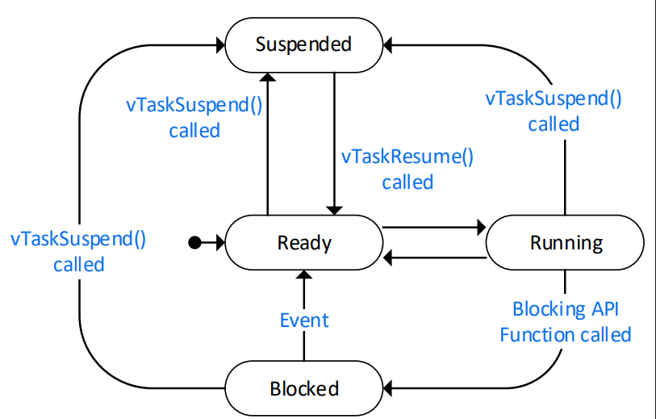
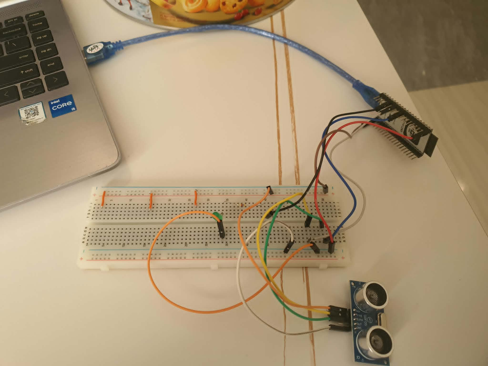

# FreeRTOS on ESP32 — 30-Day Challenge

My attempt to complete [ACLAB's 30-Day RTOS Challenge](https://github.com/nhanksd85/ACLAB_Challanges_RTOS_30Days) and learn **FreeRTOS, ESP-IDF, and real-time embedded programming** on the ESP32.

I'm documenting the entire process here: code, experiments, notes, bugs, and things I misunderstood along the way.

<p align="center">
  
  
  
  
</p>

| | Details |
|---|---|
| **Started** | September 29, 2026 |
| **Target finish** | November 1, 2026 |
| **Progress** | 7 / 30 days |
| **Board** | ESP32-DevKitC / Velxio simulator |
| **Framework** | ESP-IDF |
| **Language** | C |

---

## Table of Contents

- [Goals](#-goals)
- [Development Setup](#️-development-setup)
- [Build, Flash, and Monitor](#-build-flash-and-monitor)
- [30-Day Progress](#-30-day-progress)
- [Repository Structure](#-repository-structure)
- [Key Takeaways](#-key-takeaways)
- [Things I Got Wrong](#-things-i-got-wrong)
- [Capstone Project](#-capstone-project)
- [What I'd Do Differently](#-what-id-do-differently)
- [Resources](#-resources)

---

## 🎯 Goals

By the end of this challenge, I want to be comfortable with:

- [ ] FreeRTOS tasks and scheduling
- [ ] Task priorities and states
- [ ] Queues, semaphores, mutexes, and task notifications
- [ ] Interrupts and ISRs
- [ ] Software timers and memory management
- [ ] ESP32 multicore programming
- [ ] Debugging and runtime monitoring
- [ ] Basic real-time performance considerations

More importantly, I want to be able to **design and debug small multitasking embedded systems myself**, rather than simply copying FreeRTOS examples.

## 🛠️ Development Setup

| Component | Details |
|---|---|
| Board | ESP32-DevKitC / Velxio simulator |
| Framework | ESP-IDF |
| Language | C |
| Editor | VS Code + ESP-IDF Extension |
| OS | Windows / Linux |
| Hardware | LEDs, resistors, button, breadboard |

### Build, Flash, and Monitor

Run these commands from inside a day's project directory:

```bash
idf.py set-target esp32
idf.py build
idf.py flash
idf.py monitor
```

Or combine the operations once the project is configured:

```bash
idf.py build flash monitor
```

---

## 📚 30-Day Progress

**Legend:** ✅ Complete · 🟨 In Progress · ⬜ Not Started

### Week 1 — Tasks & Scheduling

| Day | Topic | Status | Project |
|---:|---|:---:|---|
| 01 | Introduction to RTOS & FreeRTOS | ✅ | [Day 01](Day_01_Intro/) |
| 02 | ESP-IDF Setup with VS Code | ✅ | [Day 02](Day_02_ESP_IDF/) |
| 03 | Scheduling & Core Affinity | ✅ | [Day 03](Day_03_Scheduling/) |
| 04 | Creating & Deleting Tasks | ✅ | [Day 04](Day_04_Tasks/) |
| 05 | Task States & Priorities | ✅ | [Day 05](Day_05_States/) |
| 06 | `vTaskDelay()` vs. `vTaskDelayUntil()` | ✅ | [Day 06](Day_06_Delay/) |
| 07 | Two LEDs, Two Tasks | ✅ | [Day 07](Day_07_Two_LEDs/) |

### Week 2 — Communication & Synchronization

| Day | Topic | Status | Project |
|---:|---|:---:|---|
| 08 | Queue Usage | ⬜ | [Day 08](Day_08_Queue_Monitor/) |
| 09 | Queues with ISRs | ⬜ | [Day 09](Day_09_Queue_ISR/) |
| 10 | Binary Semaphores | ⬜ | [Day 10](Day_10_Binary_Sem/) |
| 11 | Counting Semaphores | ⬜ | [Day 11](Day_11_Counting_Sem/) |
| 12 | Mutexes & Recursive Mutexes | ⬜ | [Day 12](Day_12_Mutexes/) |
| 13 | Priority Inversion | ⬜ | [Day 13](Day_13_Inversion/) |
| 14 | UART Logger + Mutex | ⬜ | [Day 14](Day_14_UART_Logger/) |

### Week 3 — Advanced FreeRTOS

| Day | Topic | Status | Project |
|---:|---|:---:|---|
| 15 | Event Groups | ⬜ | [Day 15](Day_15_Event_Groups/) |
| 16 | Task Notifications | ⬜ | [Day 16](Day_16_Notifications/) |
| 17 | Stream & Message Buffers | ⬜ | [Day 17](Day_17_Buffers/) |
| 18 | Software Timers | ⬜ | [Day 18](Day_18_Timers/) |
| 19 | Memory Management | ⬜ | [Day 19](Day_19_Memory/) |
| 20 | Interrupt Management | ⬜ | [Day 20](Day_20_Interrupts/) |
| 21 | Idle & Daemon Tasks | ⬜ | [Day 21](Day_21_Idle_Daemon/) |

### Week 4 — Debugging & Performance

| Day | Topic | Status | Project |
|---:|---|:---:|---|
| 22 | Tick Rate & Tickless Idle | ⬜ | [Day 22](Day_22_Tick/) |
| 23 | Debugging FreeRTOS Applications | ⬜ | [Day 23](Day_23_Debugging/) |
| 24 | Power Management | ⬜ | [Day 24](Day_24_Power/) |
| 25 | Inter-Task Communication | ⬜ | [Day 25](Day_25_Integration/) |
| 26 | Real-Time Trace Debugging | ⬜ | [Day 26](Day_26_Trace/) |
| 27 | Error Handling & Watchdogs | ⬜ | [Day 27](Day_27_Watchdogs/) |
| 28 | Real-Time Performance & Optimization | ⬜ | [Day 28](Day_28_Optimization/) |
| 29–30 | **Capstone Project** | ⬜ | [Capstone](Capstone/) |

---

## 📁 Repository Structure

```text
.
├── README.md
├── docs/
│   ├── cheatsheet.md
│   └── common-mistakes.md
├── Day_01_Intro/
├── Day_02_ESP_IDF/
├── Day_03_Scheduling/
├── Day_04_Tasks/
├── Day_05_States/
├── Day_06_Delay/
├── Day_07_Two_LEDs/
├── ...
├── Day_28_Optimization/
└── Capstone/
```

### Daily Project Structure

Each day will ideally contain the following files, with a README for topics that need a deeper explanation:

```text
Day_XX/
├── README.md
├── CMakeLists.txt
├── main/
│   ├── CMakeLists.txt
│   └── main.c
└── images/
```

---

## 🧠 Key Takeaways

Notes from each day, including what I learned and anything worth revisiting.

### Week 1 — Tasks & Scheduling

**Day 01 — Introduction to RTOS & FreeRTOS**
- Learned the basics of RTOS concepts and FreeRTOS.

**Day 02 — ESP-IDF Setup**
- Installed the ESP-IDF extension and got the development environment working in VS Code.

**Day 03 — Scheduling & Core Affinity**
- Learned about task scheduling, task states, core affinity, and how task priorities affect execution on the ESP32.

**Day 04 — Creating & Deleting Tasks**
- Learned about task handles, task creation, and task deletion.
- **Important note:** `vTaskDelete()` does not automatically set the application's task-handle variable to `NULL`. I need to manage that variable myself. A task deleting itself with `vTaskDelete(NULL)` should not rely on code after that call to perform cleanup.

**Day 05 — Task States & Priorities**
- Learned more about task states and priorities.



**Day 06 — Task Delays**
- Learned the differences between `vTaskDelay()` and `vTaskDelayUntil()`.
- **Extra:** Implemented the sensor-sampling portion of the challenge using an HY-SRF05 ultrasonic sensor.



**Day 07 — Two LEDs, Two Tasks**
- Completed the two-LED multitasking exercise.
- More notes and observations to be added.

### Week 2 — Queues, Semaphores & Mutexes

- *Coming soon.*

### Week 3 — Events, Notifications, Timers & Memory

- *Coming soon.*

### Week 4 — Debugging, Power & Watchdogs

- *Coming soon.*

---

## 🐛 Things I Got Wrong

A record of misconceptions, bugs, and mistakes that helped me understand the underlying concepts.

The goal is not just to document what worked, but also **why something failed and what I learned from it**.

1. **Day X — [Misconception]**
   - **What I thought:** ...
   - **What is actually happening:** ...
   - **Lesson learned:** ...

2. **Day X — [Bug or unexpected behavior]**
   - **What happened:** ...
   - **Root cause:** ...
   - **Fix:** ...

---

## 🚀 Capstone Project

The final project will combine concepts learned throughout the challenge into a small real-time embedded system.

### Project

**TBD**

### Planned Concepts

- Tasks and scheduling
- Inter-task communication
- Synchronization
- Interrupts
- Timers
- Error handling and watchdogs
- Debugging and runtime monitoring

### Demo

*Coming soon.*

---

## 🤔 What I'd Do Differently

After completing the challenge, I'll reflect on:

- Was the 30-day pacing realistic?
- Which topics required the most time?
- Which resources were the most useful?
- Which concepts should I have learned earlier?
- What would I change if I did the challenge again?

---

## 📖 Resources

- [ACLAB — 30-Day RTOS Challenge](https://github.com/nhanksd85/ACLAB_Challanges_RTOS_30Days)
- *Mastering the FreeRTOS Real Time Kernel*
- [ESP-IDF Programming Guide](https://docs.espressif.com/projects/esp-idf/en/stable/esp32/)

---

## 📄 License

This project is licensed under the MIT License. See [`LICENSE`](LICENSE) for details.
